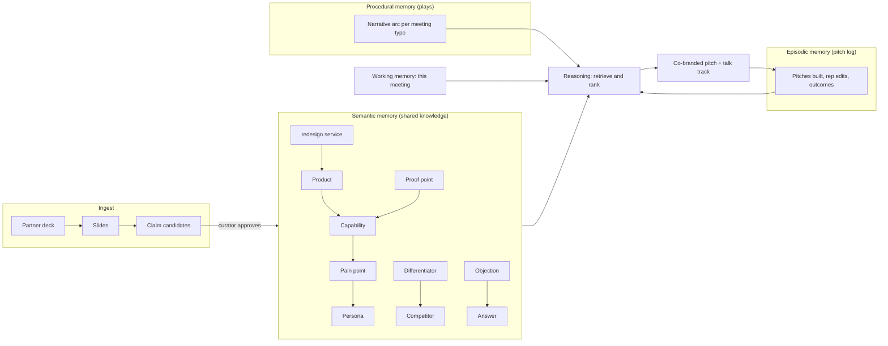

# Sales knowledge architecture

A shared model of what is inside partner decks, so sales plays work from knowledge
("what Cortex XDR does, for whom, with what proof, against whom") instead of from
slides alone. Status: K1 and the Claude hand-off (K5) are built; K2 to K4 are next.

## Decisions (2026-11)

- **The office curates.** Only the office adds, approves, merges and retires
  knowledge. A rep suggestion flow may come later.
- **No rep edition for now.** Knowledge lives in the workspace file
  (`ws.modules.plays.knowledge`); the office builds or shares pitches.
- **Partner decks may go to Claude.** The app exports deck text with instructions;
  Claude returns a knowledge pack; the app imports it as suggestions for review.

## Why

Today the library knows slides: their label, products and competitors. Reps think
in customer terms: a persona, a pain, a competitor in the account, a proof point
that lands. The gap is a layer in between that turns slide content into reusable,
shared knowledge, keeps track of where each piece came from and how fresh it is,
and gets better as pitches are used.

## The model in one picture



## The six parts

### 1. Perception (ingest)
What exists today, extended. A deck becomes slides, and each slide's bullets become
**claim candidates**: short statements with a suggested kind (capability, proof,
differentiator, objection answer). Each candidate keeps its provenance: deck, slide,
deck date, OEM, and whether the slide is internal only.

### 2. Semantic memory (the shared knowledge)
A small knowledge graph. Node types:

| Node | Example | Comes from |
| --- | --- | --- |
| OEM, Product | Palo Alto Networks, Cortex XDR | catalog (exists) |
| Capability | "Stitches endpoint, network and cloud telemetry" | claims |
| Pain point | "Too many alerts for a small SOC" | curated list, claims |
| Persona | CISO, IT director, SOC lead, CFO | curated list |
| Use case | Ransomware response, SOC consolidation | claims, slide types |
| Proof point | A stat, customer story, analyst result | claims tagged proof |
| Competitor | CrowdStrike, Nutanix | catalog (exists) |
| Differentiator | A claim scoped to one competitor | competitive slides |
| Objection and answer | "Too expensive" and the reply | competitive slides |
| redesign service | Assessment, deployment, managed service | redesign's own catalog |

Edges: product has capability; capability solves pain; pain is felt by persona;
proof supports capability; differentiator is against competitor; answer resolves
objection; redesign service attaches to product; **every node is evidenced by
slides** (provenance).

Every node carries:
- **provenance**: the slides that evidence it, so any claim traces back to the
  OEM's own words and stays co-branded and attributed
- **freshness**: the newest deck date behind it; stale knowledge is flagged like
  stale decks
- **status**: suggested, approved or retired (only approved knowledge drives
  recommendations)
- **customer safe**: false if any evidence is internal only; such knowledge feeds
  rep prep, never a customer deck

The redesign service nodes are the bridge to the business case: they say which
redesign offers to attach to which product, which is what the closing slide and
the services attach driver in the scenario engine care about.

### 3. Procedural memory (plays)
Meeting types become narrative recipes, not just a label mix:

| Meeting type | Arc |
| --- | --- |
| 15-minute intro | pain, capability, one proof, redesign next step |
| Technical deep dive | pain, architecture, integrations, deployment, redesign services |
| Executive briefing | business outcome, proof, risk of doing nothing, redesign next step |
| Competitive displacement | pain with the current tool, differentiators, objection answers, proof, migration with redesign |

Each step in an arc asks the knowledge for a node type, and the slides that
evidence it fill the step. Arcs can vary by persona (a CFO gets outcomes and proof;
a SOC lead gets capabilities and architecture).

### 4. Working memory (this meeting)
The builder's draft, extended: customer, persona, pains heard, products, competitor
in the account, meeting type, focus words. It lives only for the pitch being built.

### 5. Reasoning (retrieve and rank)
The recommender becomes a walk over the graph: persona and pains lead to
capabilities, capabilities to products and proof, the competitor to
differentiators and objection answers, each step filled by the best evidencing
slide. Ranking keeps today's signals (product fit, label mix, freshness, focus
words) and adds proof strength, persona fit and past success. Output adds a
**talk track**: one or two lines per slide drawn from the approved claims, written
into the slide's speaker notes so the rep sees why the slide is there.

### 6. Episodic memory and learning
A pitch log: each pitch built, for which account, which slides the app recommended,
which the rep removed or added, and later the outcome (rep rating, opportunity
stage from a Salesforce export). Recommended slides reps keep removing lose weight;
slides in winning pitches gain it. The office reviews the log monthly.

## Governance

- **Curator.** The office owns the knowledge: approves suggested claims, merges
  duplicates, retires stale items. Reps can suggest; only approved knowledge drives
  recommendations.
- **Attribution.** Knowledge never detaches from its source slides. Co-branding
  rules apply to anything that reaches a customer.
- **Customer safe by default.** Internal-only evidence never reaches a customer
  deck or talk track a rep might read aloud.
- **Freshness.** Knowledge inherits deck dates; a refresh of the partner deck
  re-evidences or retires nodes.

## Fit with the hard constraints

- **Offline, no network.** The app cannot call a language model. In-app extraction
  stays rules based, plus curation. An optional assisted path: export a deck's
  slide text from the app, have Claude extract claims in a separate session, and
  import the result as a knowledge pack the curator reviews. Check partner terms
  before sending partner content to any outside service; some decks are under NDA.
- **Sharing without comp data.** The workspace file holds comp and GP, so it should
  not go to reps. Knowledge travels in its own **knowledge pack** file (JSON, no
  people or financial data), alongside the slide library zip. A later "rep edition"
  could open just Sales plays with those two files.
- **One file, small.** The graph is small JSON (thousands of nodes at most), stored
  in `ws.modules.plays` for the office and exported as the knowledge pack.

## Data sketch

```ts
type NodeKind = 'product' | 'capability' | 'pain' | 'persona' | 'useCase' | 'proof'
  | 'competitor' | 'differentiator' | 'objection' | 'answer' | 'service';

interface KNode {
  id: string;
  kind: NodeKind;
  oem?: string;
  text: string;               // the claim or name, in plain language
  status: 'suggested' | 'approved' | 'retired';
  evidence: { deckId: string; slide: number }[];
  freshAsOf: string;          // newest evidencing deck date, YYYY-MM
  customerSafe: boolean;      // false if any evidence is internal only
}

interface KEdge {
  from: string;
  to: string;
  rel: 'has' | 'solves' | 'feltBy' | 'supports' | 'against' | 'answers' | 'attachesTo';
}

interface PitchLogEntry {
  at: string;
  account?: string;
  meetingType: string;
  persona?: string;
  recommended: string[];      // deckId:slide
  final: string[];
  outcome?: { rating?: 1 | 2 | 3 | 4 | 5; stage?: string };
}
```

## Build in steps

| Step | What | Depends on |
| --- | --- | --- |
| K1 (built) | Knowledge model, curation screen, starter personas and redesign services, seed from library, knowledge pack export and import | nothing |
| K2 | Claim candidates from slide bullets, review queue, provenance links | K1 |
| K3 | Persona and pains in the builder, narrative arcs, graph-based ranking, talk track in speaker notes | K1, K2 |
| K4 | Pitch log, rep edits, outcomes, learning weights | K3 |
| K5 (built) | Export for Claude (instructions plus slide text), import Claude's knowledge pack as suggestions | K1 |

## Where it lives in code

- `src/core/pitch/knowledge.ts`: node kinds, allowed links, seeding, merge, derived
  freshness and customer safety, knowledge pack import and export, Claude instructions.
- `src/modules/plays/Knowledge.tsx`: the curation screen (Sales plays > Knowledge).
- `tests/knowledge.test.ts`.
